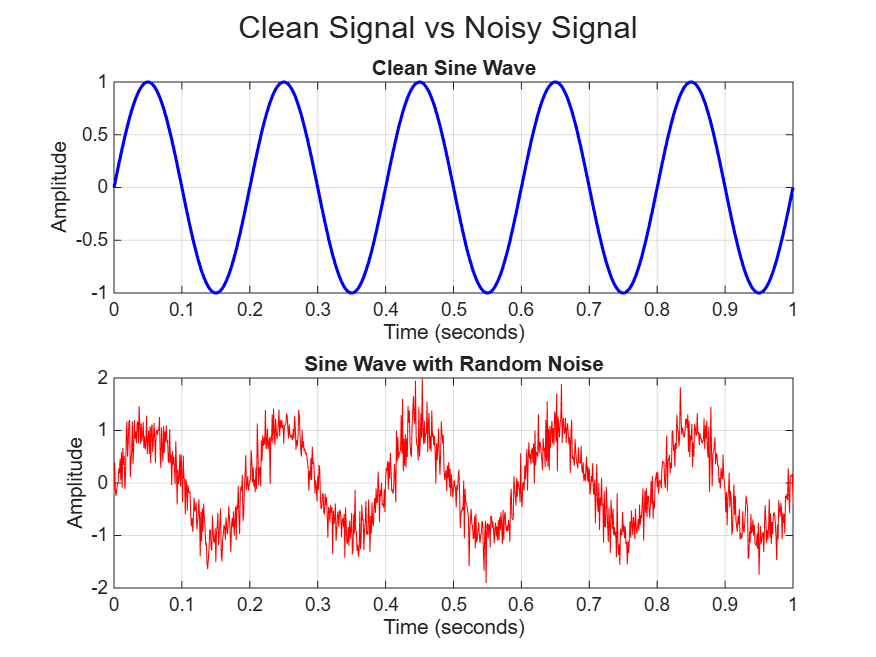

# Lecture 01: Signal Visualization Using MATLAB

## 1. Introduction

The objective of this assignment is to generate, visualize, and interpret simple signals using MATLAB. The tasks explore sine waves, frequency, amplitude, and the effect of random noise on signals.

## 2. Task 1: Create a Sine Wave

A sine wave was generated using an amplitude of 1, a frequency of 5 Hz, and a duration of 1 second. The signal was plotted against time with a title, labelled axes, and a grid.

The mathematical equation is:

\[
x(t)=A\sin(2\pi ft)
\]

Where:
- \(A\) is the amplitude.
- \(f\) is the frequency in hertz.
- \(t\) is time in seconds.

**Observation:** The waveform oscillates smoothly between -1 and +1 and completes five cycles in one second.

## 3. Task 2: Comparison of Different Frequencies

Three sine waves were generated using frequencies of 2 Hz, 5 Hz, and 10 Hz.

### Frequency Comparison Graph

**Questions and Answers**

**1. Which signal changes fastest?**

The 10 Hz signal changes fastest because it completes ten cycles per second.

**2. Which signal has the lowest frequency?**

The 2 Hz signal has the lowest frequency and completes two cycles per second.

**3. How can you see the difference in the plots?**

The difference is visible in the number of oscillations. The 10 Hz signal has the most cycles, while the 2 Hz signal has the fewest cycles over the same time interval.

## 4. Task 3: Comparison of Different Amplitudes

Three sine waves were generated with amplitudes of 0.5, 1, and 2. All signals have the same frequency of 5 Hz.

### Amplitude Comparison Graph

**Questions and Answers**

**1. Which signal has the largest amplitude?**

The signal with an amplitude of 2 has the largest amplitude.

**2. Does changing amplitude change frequency?**

No. Changing amplitude changes the height of the waveform but does not change its frequency. All three signals complete five cycles per second.

**3. Give one real-world example where amplitude is important.**

In audio systems, amplitude is related to sound pressure and perceived loudness. Greater amplitude generally corresponds to louder sound under comparable conditions.

## 5. Task 4: Adding Noise to a Signal

Random Gaussian noise was added to a clean 5 Hz sine wave to create a noisy signal.

### Clean Signal vs. Noisy Signal

**Questions and Answers**

**1. What changed after adding noise?**

The waveform became irregular because random variations were added to the clean signal.

**2. Can you still recognize the original signal?**

Yes. The repeating sine-wave pattern remains recognizable, although the added noise makes the waveform less smooth.

**3. Give one real-world source of signal noise.**

Electromagnetic interference from nearby electronic devices can introduce unwanted noise into sensor measurements.

## 6. Task 5: Saving Figures

The MATLAB script saves three figures in PNG format:

- `frequency_comparison.png`
- `amplitude_comparison.png`
- `clean_vs_noisy_signal.png`

These images are included in this README to make the results easy to view and compare on GitHub.

## 7. Task 6: Responsible Use of AI

**AI Tool Used:** ChatGPT

**Prompt:**

"Help me create a MATLAB script to generate sine waves with different frequencies and amplitudes, add random noise, display the results using subplots, and save the graphs as PNG images."

**What AI Suggested:**

ChatGPT suggested using MATLAB functions such as `sin()`, `plot()`, `subplot()`, `grid on`, `randn()`, and `saveas()` to generate, display, and save the signals.

**Did the code work immediately?**

Complete this answer after running and testing the script in MATLAB. State whether it worked immediately or required troubleshooting.

**What did you modify?**

Describe the actual changes you made after testing, such as adjusting plot labels, figure layout, or file paths. If no changes were necessary, state that honestly.

**How did you verify the result?**

Explain how you ran the script, inspected the plots, checked the expected frequencies and amplitudes, confirmed that noise was added, and verified that the three PNG files were saved.

AI was used as a learning aid. The code and results must be tested and understood before submission.

## 8. Conclusion

This assignment demonstrated how MATLAB can generate and visualize basic signals. Frequency determines the number of oscillations per second, amplitude determines the magnitude of a sine wave, and noise introduces unwanted variations. These concepts are fundamental to digital signal processing and the analysis of real-world sensor signals.

## 9. Project Files

- `Lecture01_signal_visualization.m` — MATLAB source code.
- `README.md` — Assignment explanation, observations, and answers.
- `frequency_comparison.png` — Comparison of 2 Hz, 5 Hz, and 10 Hz signals.
- `amplitude_comparison.png` — Comparison of amplitudes 0.5, 1, and 2.
- `clean_vs_noisy_signal.png` — Comparison of clean and noisy signals.

---

*All graphs are generated using the MATLAB script included in this repository.*
